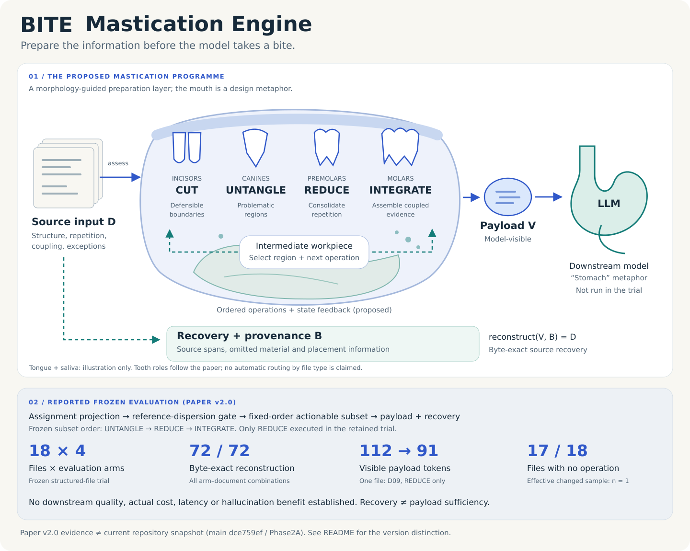

# bite-ingestion (research scaffold)

Offline-reproducible **repository scaffold** for Gate B (BITE-05).

## Stance (locked from Gate A)

- Official interim direction: **Pivot-to-bench** (evaluation / BITEBench / full-cost accounting first).
- Do **not** treat this README as a claim of architecture superiority.
- Working folder name remains `bite-ingestion`. Prefer talking about **BITEBench** and a *morphology-aware ingestion candidate*; do not advertise a standalone product acronym as settled.

## Mastication research concept



The mouth is a research metaphor: separate at defensible boundaries, isolate problematic regions, consolidate repetition, and assemble coupled evidence. The proposed programme selects regions, operations and order using input morphology and intermediate state. Tongue and saliva are illustrative, not verified software modules. This is not an automatic PDF/log router or a settled product architecture.

The model-visible payload V and recovery/provenance bundle B have different roles. Byte-exact source reconstruction does not establish that V contains enough evidence for downstream answers.

The lower panel refers to the [BITE v2.0 paper](https://doi.org/10.5281/zenodo.22925518): reconstruction was reported for all 72 arm–document combinations across 18 structured files and four arms. Only one file received REDUCE (112 to 91 visible-payload tokens); 17 received no operation. Downstream LLM quality, actual cost, latency and hallucination benefits were not established.

**Version boundary:** this repository snapshot (`dce759ef`, Phase 2A) differs from the paper's frozen `conditional_texture_policy_v5`. Do not read the paper's results or reference-dispersion gate as this branch's implementation or a reproduction performed here. Existing Pivot-to-bench status below remains unchanged. Enlarge the SVG for fine detail.

## Layout

| Area | Path | Status |
| --- | --- | --- |
| Package | `src/bite_ingestion/` | Interfaces + JSON Schemas |
| Tests | `tests/` | Offline schema / smoke |
| Config | `configs/default.toml` | Placeholders (`TBD`) |
| Gate | `scripts/gate.sh`, `scripts/gate.ps1` | lint / typecheck / test / schema |
| BITEBench slot | `bitebench/` | For BITE-06 |
| Harness slot | `harness/` | For BITE-13 |
| Artifacts / seeds | `artifacts/`, `seeds/` | Managed empties |

## Install

```bash
python -m venv .venv
pip install -e ".[dev]"
```

## Verify

```bash
./scripts/gate.sh
# or Windows: ./scripts/gate.ps1
```

## TBD (human only)

Names, datasets, APIs, numeric thresholds/budgets: keep literal `TBD`.

## Non-goals

No UI, no mandatory cloud DB, no unapproved learned models, no push/publish/purchase.

## Current status

- Historical billed pilot (`967ec0b`): decision = **pivot** (not Go)
- Phase 0 evaluator repair: complete
- Phase 1 foundation / offline arm wiring: complete
- Negative controls: complete; the instrument now reports known evidence/provenance failures
- Phase 1B benchmark pool: **24 canonical cases**, fixed **12 calibration / 12 evaluation** split
- No architecture-superiority claim
- No new paid run yet
- Phase 1C token-length condition: frozen and holdout-validated (12/12 matched without padding)
- Phase 1D confirmatory offline comparison: **PHASE1D_OFFLINE_NO_SIGNAL** (holdout 12 × frozen pair; length_pi and rule_pi both chose no-op CUT; not a paid-model result)
- Phase 2A factorial benchmark design: **DESIGN_READY_NOT_FROZEN** (24 canonical cases × 8 morphology surfaces; routing-independent)
- **Next**: Phase 2B calibration-only length control / morphology coverage. Do not open Phase 2 evaluation routing yet.

See:
- [`docs/hand_over/PHASE1-NEGATIVE-CONTROLS.md`](docs/hand_over/PHASE1-NEGATIVE-CONTROLS.md)
- [`docs/hand_over/PHASE1B-BENCHMARK-POOL-SPLIT.md`](docs/hand_over/PHASE1B-BENCHMARK-POOL-SPLIT.md)
- [`benchmarks/spec/phase1b-split-manifest.json`](benchmarks/spec/phase1b-split-manifest.json)
- [`docs/hand_over/PHASE1C-TOKEN-MATCH-FREEZE.md`](docs/hand_over/PHASE1C-TOKEN-MATCH-FREEZE.md)
- [`docs/hand_over/PHASE1D-CONFIRMATORY-OFFLINE.md`](docs/hand_over/PHASE1D-CONFIRMATORY-OFFLINE.md)
- [`docs/hand_over/PHASE2A-FACTORIAL-BENCHMARK-DESIGN.md`](docs/hand_over/PHASE2A-FACTORIAL-BENCHMARK-DESIGN.md)
- [`benchmarks/spec/phase2a-design.json`](benchmarks/spec/phase2a-design.json)
